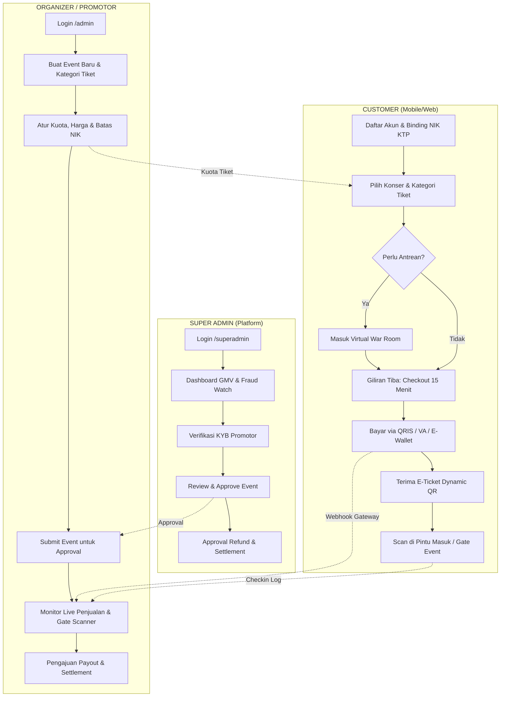

# PANDUAN OPERASIONAL, TESTING, DAN ALUR KERJA PENGGUNA
# OVATION.APP — Enterprise Concert Ticketing Platform

> Dokumen resmi panduan instalasi, langkah-langkah running aplikasi, eksekusi pengujian otomatis, serta alur kerja (*end-to-end user workflows*) untuk seluruh tingkatan pengguna (Super Admin, Organizer Promotor, dan Customer).

---

## DAFTAR ISI

1. [Ringkasan Sistem & Arsitektur](#1-ringkasan-sistem--arsitektur)
2. [Langkah-Langkah Menjalankan Aplikasi (Running Guide)](#2-langkah-langkah-menjalankan-aplikasi-running-guide)
   - [Prasyarat Sistem](#prasyarat-sistem)
   - [Step 1: Konfigurasi Environment Variable (.env)](#step-1-konfigurasi-environment-variable-env)
   - [Step 2: Migrasi Skema Database MySQL (Prisma)](#step-2-migrasi-skema-database-mysql-prisma)
   - [Step 3: Seeding Data Konser & Akun Demo](#step-3-seeding-data-konser--akun-demo)
   - [Step 4: Menjalankan Aplikasi Web (Next.js 16)](#step-4-menjalankan-aplikasi-web-nextjs-16)
   - [Step 5: Menjalankan Aplikasi Mobile (React Native Expo)](#step-5-menjalankan-aplikasi-mobile-react-native-expo)
   - [Step 6: Membuka Visual Database GUI (Prisma Studio)](#step-6-membuka-visual-database-gui-prisma-studio)
3. [Langkah-Langkah Pengujian Sistem (Testing Guide)](#3-langkah-langkah-pengujian-sistem-testing-guide)
   - [Menjalankan Automated Test Suite](#menjalankan-automated-test-suite)
   - [Penjelasan 6 Skenario Pengujian Kritis](#penjelasan-6-skenario-pengujian-kritis)
   - [Simulasi Manual Webhook Payment Gateway (Sandbox)](#simulasi-manual-webhook-payment-gateway-sandbox)
4. [Alur Kerja Lengkap Berdasarkan Role Pengguna (User Workflows)](#4-alur-kerja-lengkap-berdasarkan-role-pengguna-user-workflows)
   - [A. Super Admin Workflow (Platform Oversight & Finance)](#a-super-admin-workflow-platform-oversight--finance)
   - [B. Organizer / Promotor Admin Workflow (Event & Gate Operations)](#b-organizer--promotor-admin-workflow-event--gate-operations)
   - [C. Customer / Pembeli Workflow (Discovery, War Ticket & Dynamic E-Ticket)](#c-customer--pembeli-workflow-discovery-war-ticket--dynamic-e-ticket)
5. [Tabel Kredensial Demo & Quick Access URL](#5-tabel-kredensial-demo--quick-access-url)

---

## 1. RINGKASAN SISTEM & ARSITEKTUR

Ovation.app dirancang menggunakan arsitektur **Monorepo modern** yang memisahkan aplikasi web operasional promotor/super admin, aplikasi mobile pelanggan, serta paket modul bersama (*shared security & database*).

```
ovation-app/
├── apps/
│   ├── web/           # Next.js 16 (App Router), Tailwind CSS v4, Velvet & Amber UI (Port 3000)
│   └── mobile/        # React Native + Expo Router (Customer App untuk iOS / Android)
├── packages/
│   ├── database/      # Prisma ORM 6.4.1 (17 Tabel ACID Relasional MySQL)
│   ├── shared/        # Kriptografi TOTP HMAC-SHA256, Enkripsi AES-256 NIK KTP
│   └── validation/    # Validasi Zod Schemas (Auth, Events, Checkout, Refunds)
└── scripts/
    └── test-suite.ts  # Master Test Suite Pengujian Concurrency, Webhook & Check-in
```

---

## 2. LANGKAH-LANGKAH MENJALANKAN APLIKASI (RUNNING GUIDE)

### Prasyarat Sistem
Pastikan perangkat Anda telah terpasang:
- **Node.js**: Versi `18.x` atau lebih baru (Disarankan Node.js `22 LTS`).
- **MySQL Database**: Versi `8.0` atau `8.4` (bisa melalui Laragon, XAMPP, Docker, atau MySQL Service mandiri) yang berjalan pada port default `3306`.
- **Git** & **Terminal/PowerShell**.

---

### Step 1: Konfigurasi Environment Variable (`.env`)

Pastikan file `.env` di root direktori telah terisi sesuai konfigurasi lokal Anda:

```bash
# Salin template environment jika belum ada
cp .env.example .env
```

Contoh isi file `.env`:
```env
DATABASE_URL="mysql://root:@localhost:3306/ovation_db"
JWT_SECRET="super-secret-jwt-key-change-in-production-min-32-chars-ovation"
AUTH_SECRET="kqbm1p9yANZJUG0qqkh23stjDDb5KPLV5vbzNmQszBk="
AUTH_TRUST_HOST="true"
DATA_ENCRYPTION_KEY="ovation_secret_key_32_bytes_nik"
REDIS_URL="redis://localhost:6379"

# Midtrans Sandbox Credentials
MIDTRANS_SERVER_KEY="SB-Mid-server-YOUR_SANDBOX_SERVER_KEY"
MIDTRANS_CLIENT_KEY="SB-Mid-client-YOUR_SANDBOX_CLIENT_KEY"
MIDTRANS_IS_PRODUCTION="false"

# Xendit Sandbox Credentials
XENDIT_SECRET_KEY="xnd_development_YOUR_XENDIT_SECRET_KEY"
XENDIT_WEBHOOK_TOKEN="xnd_webhook_verification_token_here"

APP_URL="http://localhost:3000"
API_URL="http://localhost:3000/api"
NEXT_PUBLIC_APP_URL="http://localhost:3000"
```

Pastikan juga file `.env` disalin ke folder `apps/web/.env`:
```bash
cp .env apps/web/.env
```

---

### Step 2: Migrasi Skema Database MySQL (Prisma)

Buka terminal di root workspace dan jalankan perintah sinkronisasi skema Prisma ke database MySQL `ovation_db`:

```bash
# Sinkronkan 17 tabel relasional ke MySQL
npm run db:push
```

Perintah ini akan secara otomatis membuat seluruh tabel:
`users`, `organizers`, `event_categories`, `events`, `ticket_categories`, `orders`, `order_items`, `issued_tickets`, `payments`, `payment_webhook_logs`, `refund_requests`, `settlements`, `audit_logs`, `wishlists`, `virtual_queues`, `checkin_logs`, dan `notifications`.

---

### Step 3: Seeding Data Konser & Akun Demo

Jalankan perintah seed untuk mengisi database dengan konser Indonesia nyata dan akun demo terverifikasi:

```bash
npm run db:seed
```

Data yang otomatis diinjeksi meliputi:
1. **Akun Pengguna:**
   - **Super Admin:** `superadmin@ovation.id` (Password: `super123`)
   - **Promotor Musik:** `admin@ovation.id` (Password: `admin123`)
   - **Customer:** `dinda@example.com` (Password: `customer123`)
2. **Promotor Resmi:** *PT Nada Promosindo Utama* (Status: VERIFIED).
3. **Katalog Konser:**
   - *Dewa 19 Featuring All Stars Stadium Tour* (GBK Senayan, Jakarta)
   - *Sheila On 7 "Tunggu Aku Di Semarang"* (Stadion Jatidiri)
   - *We The Fest (WTF) 2026* (GBK Sports Complex)
   - *Hindia: Menari Dengan Bayangan Intimate Showcase* (Basket Hall Senayan)
4. **Kategori Tiket & Kuota:** VIP Diamond, Festival Standing, Tribune Gold, Early Bird.
5. **E-Ticket Aktif:** Contoh tiket berbayar lengkap dengan HMAC Secret untuk rotasi QR.

---

### Step 4: Menjalankan Aplikasi Web (Next.js 16)

Jalankan server aplikasi web:

```bash
npm run dev:web
```

Aplikasi web sekarang aktif dan dapat diakses melalui browser di:
👉 **[http://localhost:3000](http://localhost:3000)**

---

### Step 5: Menjalankan Aplikasi Mobile (React Native Expo)

Untuk menjalankan aplikasi mobile Customer:

```bash
# Masuk ke direktori mobile
cd apps/mobile

# Jalankan Expo bundler
npx expo start
```

Pilihan pengetesan:
1. **Perangkat Fisik Android / iOS:** Install aplikasi **Expo Go** dari Play Store / App Store, lalu scan QR code yang muncul di terminal.
2. **Web Emulator:** Tekan tombol `w` di terminal untuk membuka tampilan mobile versi web di browser.
3. **Android Emulator:** Tekan tombol `a` (memerlukan Android Studio / ADB).

---

### Step 6: Membuka Visual Database GUI (Prisma Studio)

Jika ingin memantau dan mengedit data tabel database secara visual melalui UI web:

```bash
npm run db:studio
```
Prisma Studio akan terbuka di browser pada alamat:
👉 **[http://localhost:5555](http://localhost:5555)**

---

## 3. LANGKAH-LANGKAH PENGUJIAN SISTEM (TESTING GUIDE)

### Menjalankan Automated Test Suite

Ovation.app dilengkapi dengan test runner otomatis berkecepatan tinggi yang memvalidasi integritas transaksi, keamanan, dan konkurensi database:

```bash
npm test
```

Skrip ini akan mengeksekusi file [`scripts/test-suite.ts`](./scripts/test-suite.ts) dan menampilkan laporan hasil uji secara real-time.

---

### Penjelasan 6 Skenario Pengujian Kritis

Pengujian otomatis mencakup 6 skenario wajib sesuai spesifikasi sistem tiket industri:

| No | Skenario Pengujian | Metode & Validasi | Kriteria Lolos (PASS) |
| :-: | :--- | :--- | :--- |
| **1** | **Concurrency & Anti-Overselling** | 10 permintaan checkout dikirimkan secara serentak (`Promise.all`) untuk memperebutkan **1 tiket terakhir** pada kategori kuota terbatas. | Tepat 1 transaksi berhasil, 9 transaksi lainnya gagal/ditolak. **Sisa kuota di database adalah tepat 0 (tidak pernah bernilai negatif)**. |
| **2** | **Webhook Idempotency** | Mengirimkan notifikasi webhook settlement Midtrans yang sama persis sebanyak 2 kali berturut-turut. | Panggilan pertama memproses pesanan menjadi `PAID` dan menerbitkan e-ticket. Panggilan kedua menghasilkan respons `DUPLICATE_IGNORED` tanpa menerbitkan tiket ganda. |
| **3** | **Delayed Webhook & Auto-Reconciliation** | Simulasi webhook terlambat atau tidak sampai. Pengguna mengecek status via `/api/payments/[id]/status`. | Endpoint merekonsiliasi status transaksi secara otomatis dan menyelaraskan status pesanan di database. |
| **4** | **Expired Payment & Stock Release** | Simulasi pembayaran yang melewati batas waktu kedaluwarsa 15 menit. Sistem menerima webhook `expire`. | Status order diperbarui menjadi `EXPIRED`, dan **kuota tiket yang sempat ditahan dikembalikan secara otomatis (+3 tiket)** ke inventory. |
| **5** | **RBAC Security Access Control** | Menguji percobaan akses anonim/customer ke endpoint terproteksi (`POST /api/events`, `GET /api/organizers`, `PATCH /api/refunds/[id]`). | Seluruh request tanpa wewenang dicegat dengan kode status HTTP `401 Unauthorized` atau `403 Forbidden`. |
| **6** | **Dynamic QR TOTP & Single-Use Check-in** | Menguji algoritma TOTP rotasi 30 detik pada gate scanner. | **Scan pertama:** Berhasil (`SUCCESS`) dan status tiket berubah menjadi `isCheckedIn = true`.<br>**Scan kedua (tiket sama):** Ditolak seketika (`ALREADY_CHECKED_IN`, HTTP 409) dan dicatat ke `checkin_logs`. |

---

### Simulasi Manual Webhook Payment Gateway (Sandbox)

Untuk menguji perubahan status order secara manual tanpa perlu menunggu callback asli dari Midtrans atau Xendit, gunakan endpoint simulator yang telah disediakan:

```bash
# Simulasi Pembayaran Sukses (Settlement)
curl -X POST http://localhost:3000/api/payments/simulate \
  -H "Content-Type: application/json" \
  -d '{
    "provider": "MIDTRANS",
    "orderNumber": "NOMOR_ORDER_ANDA",
    "action": "SETTLEMENT"
  }'

# Simulasi Pembayaran Kedaluwarsa (Release Stock)
curl -X POST http://localhost:3000/api/payments/simulate \
  -H "Content-Type: application/json" \
  -d '{
    "provider": "MIDTRANS",
    "orderNumber": "NOMOR_ORDER_ANDA",
    "action": "EXPIRE"
  }'
```

---

## 4. ALUR KERJA LENGKAP BERDASARKAN ROLE PENGGUNA (USER WORKFLOWS)



---

### A. SUPER ADMIN WORKFLOW (Platform Oversight & Finance)

**Tujuan:** Memantau kesehatan ekosistem tiket nasional, menyetujui promotor & konser legal, mencegah sindikat calo tiket, dan mengelola dana transaksi.

1. **Autentikasi:**
   - Buka URL: `http://localhost:3000/login`
   - Gunakan tombol **"⚡ 1-Click Fast Pass: Super Admin"** atau masukkan:
     - Email: `superadmin@ovation.id`
     - Password: `super123`
   - Sistem mengarahkan ke portal terproteksi: `http://localhost:3000/superadmin`.
2. **Monitoring Dashboard GMV:**
   - Memantau metrik Gross Merchandise Value (GMV), total tiket terjual, platform fee terkumpul (5%), dan transaksi aktif secara real-time.
3. **Verifikasi Legalitas Promotor (KYB):**
   - Meninjau berkas pendaftaran promotor baru (Nama Perusahaan, NPWP, Rekening Bank Pencairan).
   - Melakukan tindakan **VERIFY** untuk mengizinkan promotor merilis tiket ke publik, atau **REJECT** jika dokumen tidak sah.
4. **Moderasi & Approval Event:**
   - Memeriksa draft event yang disubmit oleh promotor (kelayakan venue, izin kepolisian, rasio kuota).
   - Mengubah status event menjadi `PUBLISHED` agar muncul di halaman pencarian pembeli.
5. **Approval Refund & Sengketa:**
   - Meninjau tiket refund yang telah disetujui promotor. Super Admin melakukan persetujuan akhir (*Superadmin Approved*) untuk memicu transfer balik dana ke pelanggan.
6. **Audit Trail & Anti-Fraud Bot:**
   - Memeriksa log aktivitas sistem (`/api/audit-logs`) untuk mendeteksi IP mencurigakan atau pola pemesanan bot calo yang mencoba memborong kuota.

---

### B. ORGANIZER / PROMOTOR ADMIN WORKFLOW (Event & Gate Operations)

**Tujuan:** Merancang konser, mengatur tingkatan harga tiket, mengontrol kuota war ticket, dan mengoperasikan gate check-in pada hari acara.

1. **Autentikasi:**
   - Buka URL: `http://localhost:3000/login`
   - Gunakan tombol **"⚡ 1-Click Fast Pass: Promoter Admin"** atau masukkan:
     - Email: `admin@ovation.id`
     - Password: `admin123`
   - Sistem mengarahkan ke dashboard: `http://localhost:3000/admin`.
2. **Pembuatan Event Konser:**
   - Klik **"Buat Event Baru"**.
   - Masukkan informasi: Judul konser, artis/lineup, deskripsi, tanggal pelaksanaan, venue, dan kota.
   - Upload poster grafis konser.
3. **Konfigurasi Kategori Tiket & Kuota:**
   - Tambahkan tier tiket (misal: *VIP Diamond Rp 2.500.000*, *Festival Standing Rp 1.100.000*).
   - Tentukan **Total Kuota** penjualan.
   - Tetapkan **Maksimal Tiket per Transaksi/Akun** (misal: maks. 4 tiket) untuk memutus gerak spekulan/calo.
   - Aktifkan opsi **Virtual Queue War Room** untuk konser ber-demand tinggi.
4. **Pengajuan Approval:**
   - Mengirimkan (*Submit*) event ke Super Admin untuk proses kurasi dan publikasi resmi.
5. **Live Sales Dashboard & War Monitoring:**
   - Memantau grafik penjualan tiket harian, persentase keterisian venue (*occupancy rate*), dan grafik pergerakan antrean virtual.
6. **Operasional Gate Scanner Check-in (Hari H Konser):**
   - Staf pintu masuk menggunakan endpoint pemindaian tiket `/api/checkin/validate`.
   - Mengarahkan scanner ke dynamic QR pelanggan.
   - Layar menampilkan data pengunjung (Nama, Tier, NIK Masked `************0004`).
   - Sistem otomatis menolak jika tiket yang sama dipindai dua kali di gate lain.
7. **Penyelesaian Pendapatan (Settlement & Payout):**
   - Mengakses tab **Settlement**.
   - Sistem menghitung:
     $$\text{Pendapatan Bersih} = \text{Total Penjualan} - \text{Platform Fee (5\%)} - \text{Refund Terselesaikan}$$
   - Promotor mengajukan permohonan pencairan dana ke rekening bank yang telah terverifikasi.

---

### C. CUSTOMER / PEMBELI WORKFLOW (Discovery, War Ticket & Dynamic E-Ticket)

**Tujuan:** Menjelajah konser musik favorit, mengamankan tiket saat war, melakukan pembayaran resmi, dan menggunakan e-ticket digital anti-palsu di lokasi konser.

1. **Registrasi Akun & Binding NIK KTP:**
   - Buka aplikasi Mobile atau Web (`/register`).
   - Masukkan Nama Sesuai KTP, Email, No. WhatsApp, Password, dan **16 Digit NIK KTP**.
   - *Keamanan Identitas:* Sistem mengenkripsi NIK menggunakan **AES-256-CBC**. Hanya 4 digit terakhir yang dapat dilihat staf tiket, melindungi privasi penuh pembeli.
   - *Alternatif Uji Coba Cepat:* Gunakan akun demo pelanggan:
     - Email: `dinda@example.com`
     - Password: `customer123`
2. **Eksplorasi Konser & Wishlist:**
   - Menjelajahi halaman utama (daftar konser Sheila On 7, Dewa 19, Hindia, We The Fest).
   - Membaca detail rundown, denah tempat duduk (seating layout), dan syarat & ketentuan acara.
   - Menekan tombol Wishlist untuk menyimpan konser favorit.
3. **War Ticket & Virtual Queue (Ruang Tunggu Virtual):**
   - Saat penjualan tiket dibuka serentak, pelanggan diarahkan ke **Virtual War Room** (`/events/[id]/queue`).
   - Sistem menerbitkan `queueToken` unik berbasis identitas akun dan IP pelanggan.
   - Pelanggan melihat nomor urut antrean, progress bar dinamis, dan estimasi waktu tunggu.
   - Fitur ini mencegah server crash akibat ratusan ribu request per detik.
4. **Checkout Terproteksi (15-Minute Reservation Window):**
   - Saat giliran tiba, pelanggan dialihkan ke halaman **Checkout** (`/events/[id]/checkout`).
   - Sistem melakukan *reserve kuota* secara atomik (`SELECT FOR UPDATE`), menjamin kuota tidak diserobot pengguna lain selama 15 menit.
   - Memilih jumlah tiket (maksimal sesuai aturan event, misal 2 atau 4 tiket).
   - Memilih metode pembayaran:
     - **QRIS Dinamis:** Scan langsung via GoPay, BCA Mobile, Livin Mandiri, OVO, Dana.
     - **Virtual Account (VA):** BCA, Mandiri, BNI, BRI (nomor rekening virtual otomatis terbuat).
     - **Kartu Kredit / Debit Online**.
5. **Konfirmasi Pembayaran Otomatis:**
   - Setelah membayar, gateway mengirimkan notifikasi webhook ke backend.
   - Backend memverifikasi signature hash SHA-512 dan mengubah status order menjadi `PAID`.
   - Kuota tiket resmi terpotong permanen.
6. **Penerbitan E-Ticket Dynamic QR (Anti-Calo):**
   - Pelanggan membuka menu **"Tiket Saya"** (`/account/tickets` atau tab Mobile).
   - Tiket memuat kode unik dan **Dynamic QR Code** yang berotasi otomatis setiap **30 detik** menggunakan algoritma TOTP (Time-based One-Time Password).
   - Tangkapan layar (*screenshot*) yang dibagikan ke orang lain akan kedaluwarsa dalam 30 detik sehingga **tidak dapat digunakan oleh calo**.
7. **Gate Check-in di Venue:**
   - Di pintu masuk konser, pelanggan menunjukkan dynamic QR dari aplikasi mobile Ovation.
   - Staf memindai QR code $\to$ Tiket tervalidasi $\to$ Gelang konser diserahkan.
8. **Pengajuan Refund (Bila Diperlukan):**
   - Jika konser dibatalkan atau pengguna memenuhi syarat kebijakan pengembalian dana, pelanggan dapat menekan tombol **"Ajukan Refund"** pada riwayat pesanan.

---

## 5. TABEL KREDENSIAL DEMO & QUICK ACCESS URL

Semua kredensial berikut telah tersedia di database secara default setelah proses seeding:

| Role Pengguna | Email | Password | Halaman Akses Utama |
| :--- | :--- | :--- | :--- |
| **Super Admin** | `superadmin@ovation.id` | `super123` | [`http://localhost:3000/superadmin`](http://localhost:3000/superadmin) |
| **Promotor / Organizer** | `admin@ovation.id` | `admin123` | [`http://localhost:3000/admin`](http://localhost:3000/admin) |
| **Customer (Pelanggan)** | `dinda@example.com` | `customer123` | [`http://localhost:3000/account/tickets`](http://localhost:3000/account/tickets) |

### Shortcut URL Cepat
- **Homepage & Discovery Konser:** [http://localhost:3000](http://localhost:3000)
- **Halaman Login (Fast Pass 1-Klik):** [http://localhost:3000/login](http://localhost:3000/login)
- **Halaman Pendaftaran Akun:** [http://localhost:3000/register](http://localhost:3000/register)
- **Virtual War Room Konser Dewa 19:** [http://localhost:3000/events/cmw529irq000ey96gejhyrw0z/queue](http://localhost:3000/events/cmw529irq000ey96gejhyrw0z/queue)
- **Dompet E-Ticket Dynamic QR Pelanggan:** [http://localhost:3000/account/tickets](http://localhost:3000/account/tickets)
- **Prisma Studio Visual Database:** [http://localhost:5555](http://localhost:5555) (jalankan via `npm run db:studio`)

---

*Dokumentasi ini disusun oleh Ovation Engineering Team sesuai standar industri Loket.com, Tiket.com, dan Traveloka.*

