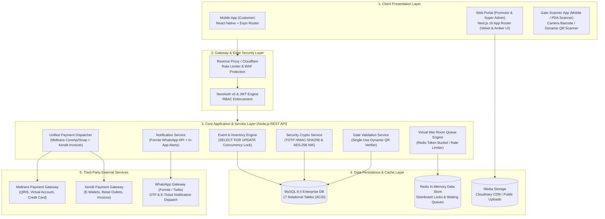
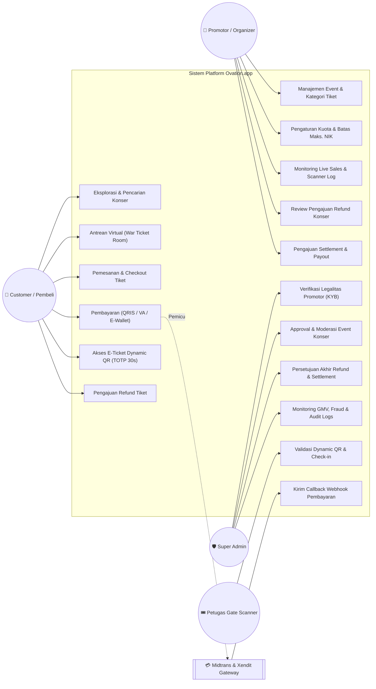
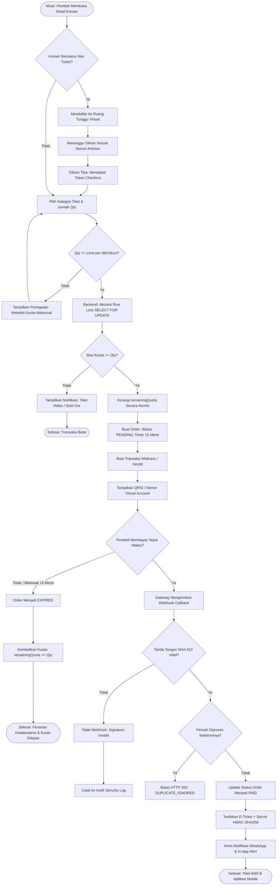
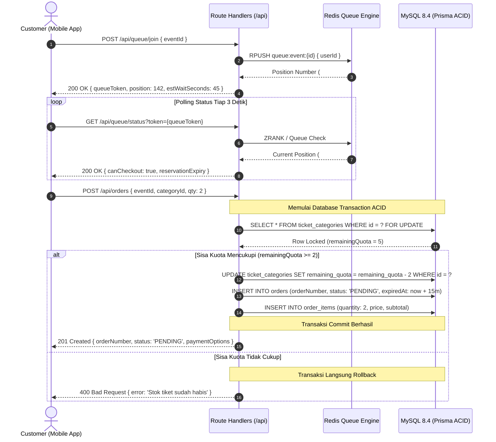
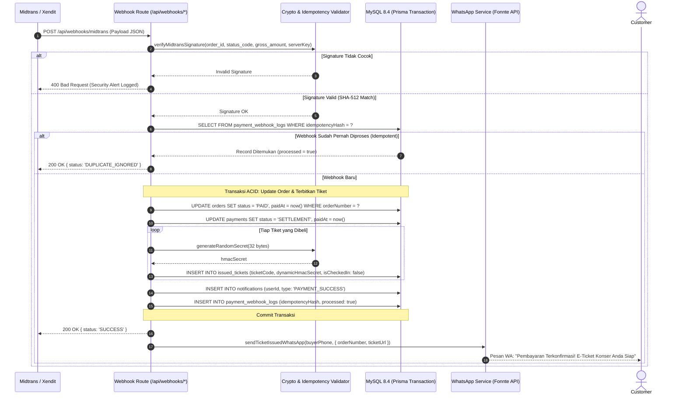
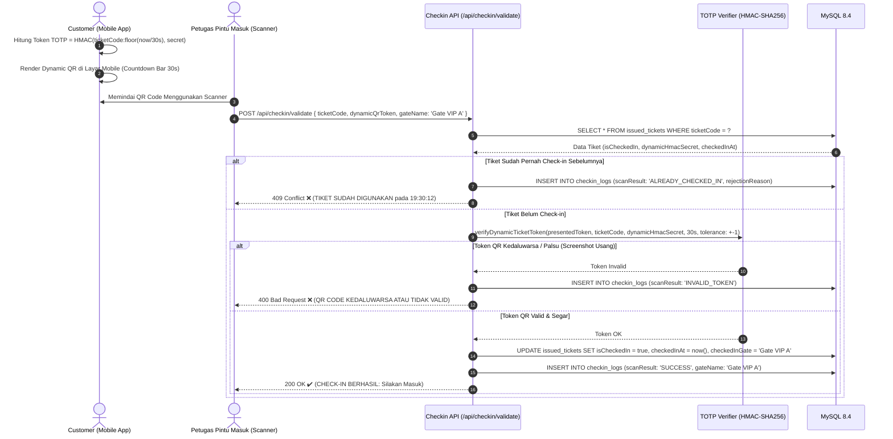
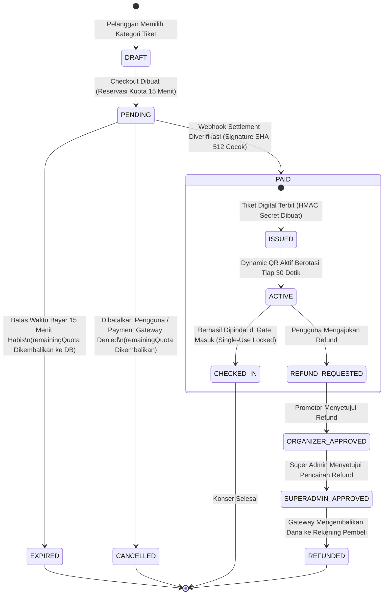
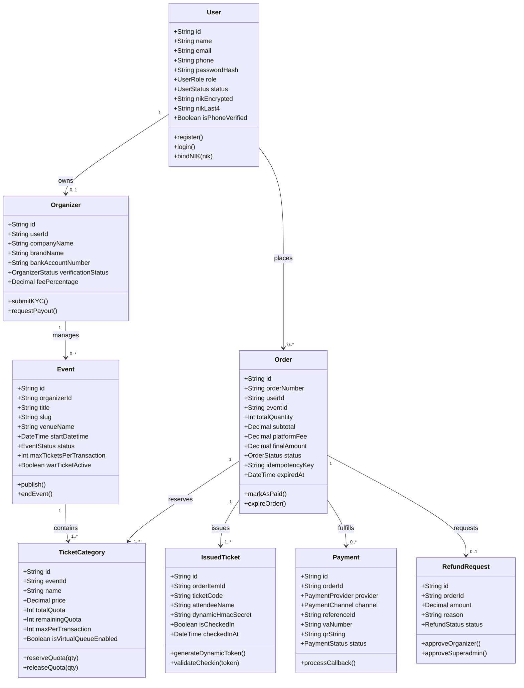

# DOKUMEN RANCANGAN SISTEM, DIAGRAM UML, DAN ENTITY-RELATIONSHIP DIAGRAM (ERD)
# PLATFORM PEMESANAN TIKET KONSER ONLINE (OVATION.APP)

> **Standar Arsitektur:** Loket.com, Tiket.com, dan Traveloka.  
> **Klasifikasi Proyek:** Enterprise High-Concurrency Ticketing Platform (Monorepo Next.js 16 + React Native Expo + MySQL 8.4 + Prisma ORM + Redis + Midtrans & Xendit Dual Gateway).

---

## DAFTAR ISI

1. [Rancangan Arsitektur Sistem (System Architecture Design)](#1-rancangan-arsitektur-sistem-system-architecture-design)
   - [1.1 Gambaran Arsitektur Global](#11-gambaran-arsitektur-global)
   - [1.2 Komponen dan Lapisan Sistem (Tier Architecture)](#12-komponen-dan-lapisan-sistem-tier-architecture)
   - [1.3 Arsitektur Keamanan & Anti-Calo](#13-arsitektur-keamanan--anti-calo)
2. [Diagram Unified Modeling Language (UML)](#2-diagram-unified-modeling-language-uml)
   - [2.1 Use Case Diagram (Seluruh Aktor & Hak Akses)](#21-use-case-diagram)
   - [2.2 Activity Diagram: Alur Pemesanan & Pembayaran Tiket](#22-activity-diagram-alur-pemesanan--pembayaran-tiket)
   - [2.3 Sequence Diagram 1: Virtual Queue War Room & Reservasi Kuota](#23-sequence-diagram-1-virtual-queue-war-room--reservasi-kuota)
   - [2.4 Sequence Diagram 2: Webhook Payment Gateway, Idempotency & E-Ticket Issuance](#24-sequence-diagram-2-webhook-payment-gateway-idempotency--e-ticket-issuance)
   - [2.5 Sequence Diagram 3: Dynamic QR TOTP & Single-Use Gate Check-in](#25-sequence-diagram-3-dynamic-qr-totp--single-use-gate-check-in)
   - [2.6 State Machine Diagram: Siklus Hidup Pesanan & Tiket (Order & Ticket Lifecycle)](#26-state-machine-diagram-siklus-hidup-pesanan--tiket)
   - [2.7 Class Diagram: Struktur Model & Kontrak Domain](#27-class-diagram-struktur-model--kontrak-domain)
3. [Entity-Relationship Diagram (ERD) & Kamus Data](#3-entity-relationship-diagram-erd--kamus-data)
   - [3.1 Visualisasi ERD Lengkap (17 Entitas Relasional MySQL)](#31-visualisasi-erd-lengkap-17-entitas-relasional-mysql)
   - [3.2 Kamus Data & Spesifikasi Tabel Utama](#32-kamus-data--spesifikasi-tabel-utama)
   - [3.3 Skema Indexing & Integritas Referensial](#33-skema-indexing--integritas-referensial)

---

## 1. RANCANGAN ARSITEKTUR SISTEM (SYSTEM ARCHITECTURE DESIGN)

### 1.1 Gambaran Arsitektur Global

Ovation.app mengadopsi pola **Event-Driven Monorepo Architecture** yang mengintegrasikan aplikasi web untuk admin/promotor, aplikasi mobile untuk pembeli, dan micro-service modular untuk antrean virtual serta gateway pembayaran.

---

### 1.2 Komponen dan Lapisan Sistem (Tier Architecture)

1. **Presentation Layer:**
   - **Customer Mobile:** Dibangun dengan React Native dan Expo Router, menggunakan React Query untuk caching status antrean dan SVG QR renderer untuk memutar token dinamis secara offline-resilient.
   - **Organizer & Super Admin Web:** Next.js 16 (Turbopack) dengan tema *Velvet & Amber* (`#090A0F`, `#7C3AED`, `#F59E0B`), visualisasi chart GMV, form wizard event bertingkat, dan scanner log monitor.
2. **Business Logic & API Layer:**
   - REST API terpusat berbasis Next.js Route Handlers (`/api/events`, `/api/orders`, `/api/payments`, `/api/checkin/validate`, `/api/queue`).
   - Role-Based Access Control (RBAC) ketat yang memisahkan otoritas `CUSTOMER`, `ORGANIZER`, dan `SUPER_ADMIN`.
3. **High-Concurrency Engine:**
   - **Distributed Lock:** Mencegah *race condition* dan *overselling* saat pembukaan tiket serentak (*ticket war*).
   - **Row-Level Lock (InnoDB):** Mengunci record kategori tiket dengan klausa `SELECT ... FOR UPDATE` dan *conditional update* `WHERE remaining_quota >= qty`.
4. **Data Persistence Layer:**
   - **MySQL 8.4:** Menampung seluruh data transaksional dengan jaminan ACID penuh, foreign key constraints, dan unique indexes.
   - **Redis Store:** Menangani antrean *Virtual Waiting Room*, token antrean bertanda tangan, dan distributed mutex.

---

### 1.3 Arsitektur Keamanan & Anti-Calo

- **Enkripsi NIK Identitas Pembeli:** Nomor Induk Kependudukan (16 digit) dienkripsi menggunakan algoritma **AES-256-CBC**. Hanya 4 digit terakhir (`nikLast4`) yang disimpan dalam bentuk teks biasa untuk verifikasi staf pintu masuk (`************0004`).
- **Dynamic QR E-Ticket (TOTP HMAC-SHA256):** Token QR dibuat menggunakan formula:
  $$\text{Token} = \text{ticketCode} + \text{"-"} + \text{HMAC-SHA256}(\text{ticketCode} + \text{":"} + \lfloor\text{now} / 30000\rfloor, \text{secret})[0..8]$$
  Token berotasi otomatis setiap **30 detik**. Tangkapan layar (*screenshot*) yang dibagikan atau dijual calo otomatis hangus dalam 30 detik.
- **Idempotensi Pembayaran:** Webhook payment gateway menghitung SHA-256 hash payload. Duplikasi panggilan callback langsung dijawab dengan status `DUPLICATE_IGNORED` tanpa memicu pencetakan tiket ganda.

---

## 2. DIAGRAM UNIFIED MODELING LANGUAGE (UML)

### 2.1 Use Case Diagram

Diagram berikut memetakan interaksi seluruh aktor (*Customer*, *Promotor / Organizer*, *Super Admin*, *Petugas Gate*, dan *Payment Gateway*) terhadap kapabilitas sistem Ovation.

---

### 2.2 Activity Diagram: Alur Pemesanan & Pembayaran Tiket

Menggambarkan alur aktivitas pembeli mulai dari pemilihan tiket, pengantrean virtual, pemesanan atomik, pembayaran, hingga tiket diterbitkan atau kuota dikembalikan jika kedaluwarsa.

---

### 2.3 Sequence Diagram 1: Virtual Queue War Room & Reservasi Kuota

Alur interaksi pembeli saat memperebutkan tiket konser berkategori *high-demand* melalui ruang antrean virtual dan transaksi database atomik:

---

### 2.4 Sequence Diagram 2: Webhook Payment Gateway, Idempotency & E-Ticket Issuance

Alur penerimaan callback notifikasi dari payment gateway, verifikasi integritas data, pencegahan pembayaran ganda, serta penerbitan e-ticket dan notifikasi:

---

### 2.5 Sequence Diagram 3: Dynamic QR TOTP & Single-Use Gate Check-in

Alur pemindaian e-ticket di pintu masuk venue konser, validasi token berotasi 30 detik, dan penolakan tiket ganda secara instan:

---

### 2.6 State Machine Diagram: Siklus Hidup Pesanan & Tiket

---

### 2.7 Class Diagram: Struktur Model & Kontrak Domain

---

## 3. ENTITY-RELATIONSHIP DIAGRAM (ERD) & KAMUS DATA

### 3.1 Visualisasi ERD Lengkap (17 Entitas Relasional MySQL)

Diagram relasi entitas berikut memetakan ke-17 tabel yang didefinisikan dalam skema Prisma ORM (`packages/database/prisma/schema.prisma`), mencakup relasi *one-to-one*, *one-to-many*, dan relasi ketergantungan cascading:

```mermaid
erDiagram
    USERS ||--o| ORGANIZERS : "memiliki profil promotor"
    USERS ||--o{ ORDERS : "melakukan pemesanan"
    USERS ||--o{ WISHLISTS : "menyimpan konser favorit"
    USERS ||--o{ VIRTUAL_QUEUES : "mengantre di war room"
    USERS ||--o{ NOTIFICATIONS : "menerima notifikasi"
    USERS ||--o{ AUDIT_LOGS : "mencatat jejak aktivitas"
    USERS ||--o{ CHECKIN_LOGS : "staf gate melakukan scan"

    ORGANIZERS ||--o{ EVENTS : "menyelenggarakan"
    ORGANIZERS ||--o{ SETTLEMENTS : "mengajukan pencairan dana"

    EVENT_CATEGORIES ||--o{ EVENTS : "mengelompokkan genre"

    EVENTS ||--o{ TICKET_CATEGORIES : "memiliki tier tiket"
    EVENTS ||--o{ ORDERS : "menjadi objek pemesanan"
    EVENTS ||--o{ WISHLISTS : "dimasukkan ke wishlist"
    EVENTS ||--o{ VIRTUAL_QUEUES : "antrean tiket konser"
    EVENTS ||--o{ SETTLEMENTS : "sumber pendapatan"

    TICKET_CATEGORIES ||--o{ ORDER_ITEMS : "dipesan dalam baris item"

    ORDERS ||--|{ ORDER_ITEMS : "memiliki rincian item"
    ORDERS ||--o{ PAYMENTS : "memiliki transaksi pembayaran"
    ORDERS ||--o{ REFUND_REQUESTS : "dapat diajukan refund"

    ORDER_ITEMS ||--|{ ISSUED_TICKETS : "menerbitkan tiket individual"

    ISSUED_TICKETS ||--o{ CHECKIN_LOGS : "riwayat pemindaian scanner"

    USERS {
        string id PK "cuid"
        string email UK "Email unik pelanggan/staf"
        string password_hash "Bcrypt hash"
        string name "Nama lengkap pengguna"
        string phone "No. WhatsApp"
        enum role "SUPER_ADMIN | ORGANIZER | CUSTOMER"
        enum status "ACTIVE | SUSPENDED | PENDING_VERIFICATION"
        string nik_encrypted "Enkripsi AES-256-CBC"
        string nik_last4 "4 digit terakhir untuk tampilan"
        datetime created_at
        datetime updated_at
    }

    ORGANIZERS {
        string id PK "cuid"
        string user_id FK,UK "Relasi 1:1 ke USERS"
        string company_name "Nama legal PT/CV"
        string brandName "Nama promotor di publik"
        string bank_name "Bank tujuan pencairan"
        string bank_account_number "No. rekening promotor"
        string npwp "Nomor Pokok Wajib Pajak"
        enum verification_status "PENDING | VERIFIED | REJECTED"
        decimal fee_percentage "Platform fee (default 5.00%)"
        datetime created_at
    }

    EVENT_CATEGORIES {
        string id PK "cuid"
        string name "Rock, Pop, Indie, Jazz"
        string slug UK "rock, pop, indie"
        string description
    }

    EVENTS {
        string id PK "cuid"
        string organizer_id FK "Relasi ke ORGANIZERS"
        string category_id FK "Relasi ke EVENT_CATEGORIES"
        string title "Judul resmi konser musik"
        string slug UK "slug-url-ramah-seo"
        string venue_name "Stadion GBK, JIExpo, dll."
        string venue_city "Jakarta, Semarang, Bali"
        datetime start_datetime "Waktu konser dimulai"
        enum status "DRAFT | SUBMITTED | PUBLISHED | REJECTED | ENDED"
        int max_tickets_per_transaction "Batas tiket (default 4)"
        boolean war_ticket_active "Toggle Virtual Queue War"
        datetime created_at
    }

    TICKET_CATEGORIES {
        string id PK "cuid"
        string event_id FK "Relasi ke EVENTS"
        string name "VIP Diamond, Festival Standing"
        decimal price "Harga per tiket (Decimal 12,2)"
        int total_quota "Kuota total yang dirilis"
        int remaining_quota "Sisa kuota real-time (Concurrency Lock)"
        int max_per_transaction "Limit per transaksi pembeli"
        boolean is_virtual_queue_enabled "Proteksi War Room"
        boolean is_standing "Kategori berdiri atau duduk"
        datetime sales_start_time
        datetime sales_end_time
    }

    ORDERS {
        string id PK "cuid"
        string order_number UK "OVN-XXXXXX unik"
        string user_id FK "Relasi ke USERS (Pembeli)"
        string event_id FK "Relasi ke EVENTS"
        int total_quantity "Total lembar tiket dipesan"
        decimal subtotal "Total harga dasar tiket"
        decimal platform_fee "Biaya platform Ovation (5%)"
        decimal admin_fee "Biaya administrasi (Rp 5.000)"
        decimal final_amount "Total pembayaran final"
        enum status "PENDING | PAID | EXPIRED | CANCELLED | REFUNDED"
        string payment_method "QRIS, BCA_VA, CREDIT_CARD"
        string idempotency_key UK "Kunci anti pesanan duplikat"
        datetime expired_at "Batas waktu bayar 15 menit"
        datetime paid_at
    }

    ORDER_ITEMS {
        string id PK "cuid"
        string order_id FK "Relasi ke ORDERS"
        string ticket_category_id FK "Relasi ke TICKET_CATEGORIES"
        int quantity "Jumlah lembar tiket tier ini"
        decimal unit_price "Harga per lembar"
        decimal subtotal
    }

    ISSUED_TICKETS {
        string id PK "cuid"
        string order_item_id FK "Relasi ke ORDER_ITEMS"
        string ticket_code UK "TKT-DEW-VIP-XXXXX unik"
        string attendee_name "Nama pemilik tiket"
        string attendee_nik_encrypted "AES-256 NIK Pemegang"
        string attendee_nik_last4 "4 digit NIK pemegang"
        string dynamic_hmac_secret "Kunci rahasia TOTP 32 bytes"
        boolean is_checked_in "Status kehadiran di venue"
        datetime checked_in_at "Waktu lolos check-in"
        string checked_in_gate "Nama pintu masuk (Gate VIP A)"
    }

    PAYMENTS {
        string id PK "cuid"
        string order_id FK "Relasi ke ORDERS"
        enum provider "MIDTRANS | XENDIT"
        enum channel "QRIS | VIRTUAL_ACCOUNT | EWALLET | CREDIT_CARD"
        string reference_id UK "ID transaksi dari payment gateway"
        string merchant_order_id "ID order lokal"
        string payment_url "URL redirect pembayaran Snap/Invoice"
        string va_number "Nomor Virtual Account bank"
        string qr_string "Payload string QRIS dinamis"
        decimal amount "Nominal uang yang ditagihkan"
        enum status "PENDING | SETTLEMENT | EXPIRE | CANCEL | REFUND"
        datetime paid_at
        datetime expired_at
    }

    PAYMENT_WEBHOOK_LOGS {
        string id PK "cuid"
        enum provider "MIDTRANS | XENDIT"
        string reference_id "Reference ID provider"
        string order_number "Nomor order lokal"
        string event_type "settlement, expire, capture"
        boolean signature_valid "Status verifikasi tanda tangan"
        string idempotency_hash UK "Hash SHA-256 anti duplikat"
        text raw_payload "JSON mentah callback"
        boolean processed "Status pemrosesan callback"
        string processing_error "Catatan error jika gagal"
    }

    REFUND_REQUESTS {
        string id PK "cuid"
        string order_id FK "Relasi ke ORDERS"
        string user_id FK "Relasi ke USERS (Pemohon)"
        decimal amount "Nominal dana yang diminta"
        text reason "Alasan refund"
        string bank_name "Bank tujuan pengembalian"
        string bank_account_number "Nomor rekening tujuan"
        enum status "REQUESTED | ORGANIZER_APPROVED | SUPERADMIN_APPROVED | REJECTED | COMPLETED"
        datetime reviewed_by_organizer_at
        datetime reviewed_by_superadmin_at
    }

    SETTLEMENTS {
        string id PK "cuid"
        string organizer_id FK "Relasi ke ORGANIZERS"
        string settlement_number UK "SETTLE-XXXXXX unik"
        decimal gross_revenue "Total penerimaan kotor"
        decimal platform_fee_deducted "Potongan fee platform"
        decimal net_payout "Pendapatan bersih dicairkan"
        enum status "PENDING | APPROVED | TRANSFERRED | REJECTED"
        string transfer_proof_url "Bukti transfer bank"
        datetime transferred_at
    }

    AUDIT_LOGS {
        string id PK "cuid"
        string actor_user_id FK "Pelaku aksi (Staf/User)"
        string action "EVENT_APPROVE, REFUND_PAYOUT"
        string entity_type "Event, Order, Organizer"
        string entity_id "ID baris yang diubah"
        string ip_address "IP Address aktor"
        string user_agent "Perangkat browser/mobile"
        text metadata "Snapshot JSON sebelum & sesudah"
        datetime created_at
    }

    WISHLISTS {
        string id PK "cuid"
        string user_id FK "Relasi ke USERS"
        string event_id FK "Relasi ke EVENTS"
        datetime created_at
    }

    VIRTUAL_QUEUES {
        string id PK "cuid"
        string event_id FK "Relasi ke EVENTS"
        string user_id FK "Relasi ke USERS"
        string queue_token UK "Token bertanda tangan kriptografis"
        int queue_number "Nomor urut antrean"
        enum status "WAITING | ADMITTED | EXPIRED | CANCELLED"
        string ip_address "Alamat IP pembeli"
        datetime admitted_at "Waktu masuk checkout"
        datetime expired_at "Batas waktu checkout"
    }

    CHECKIN_LOGS {
        string id PK "cuid"
        string issued_ticket_id FK "Relasi ke ISSUED_TICKETS"
        string scanned_by_user_id FK "Staf gate pemindai"
        string gate_name "Pintu Barat, Pintu VIP A"
        enum scan_result "SUCCESS | ALREADY_CHECKED_IN | INVALID_TOKEN | EXPIRED_TOKEN"
        string rejection_reason "Penyebab tiket ditolak"
        string dynamic_token_provided "Token TOTP yang disodorkan"
        datetime scanned_at
    }

    NOTIFICATIONS {
        string id PK "cuid"
        string user_id FK "Relasi ke USERS"
        string title "Judul notifikasi"
        text message "Isi pesan"
        enum type "PAYMENT_SUCCESS | PAYMENT_EXPIRED | REFUND_UPDATE | QUEUE_ADMITTED"
        boolean is_read "Status telah dibaca"
        string link_url "Tautan ke tiket / pesanan"
        datetime created_at
    }
```

---

### 3.2 Kamus Data & Spesifikasi Tabel Utama

#### A. Tabel `ticket_categories` (Pusat Concurrency & Inventory Control)
| Kolom | Tipe Data | Constraint | Keterangan Fungsional |
| :--- | :--- | :--- | :--- |
| `id` | `VARCHAR(30)` | PK, CUID | Identifier unik kategori tiket. |
| `event_id` | `VARCHAR(30)` | FK $\to$ `events.id` | Konser pemilik kategori tiket ini (Cascade delete). |
| `name` | `VARCHAR(100)` | NOT NULL | Nama tier (Contoh: VIP Diamond, Festival Standing). |
| `price` | `DECIMAL(12,2)` | NOT NULL | Harga dasar tiket per lembar (dalam Rupiah). |
| `total_quota` | `INT` | NOT NULL | Alokasi kapasitas total yang disediakan promotor. |
| `remaining_quota` | `INT` | NOT NULL, INDEX | Sisa stok tiket real-time. **Dikuasai oleh exclusive lock `SELECT FOR UPDATE`** dan dicek dengan syarat `remaining_quota >= qty`. |
| `max_per_transaction` | `INT` | DEFAULT 4 | Batas maksimal lembar tiket yang dapat dibeli dalam satu transaksi/akun untuk mencegah calo. |
| `is_virtual_queue_enabled`| `BOOLEAN` | DEFAULT false | Menentukan apakah pembelian wajib melalui Virtual War Room. |

#### B. Tabel `issued_tickets` (Pusat Anti-Calo & Dynamic QR)
| Kolom | Tipe Data | Constraint | Keterangan Fungsional |
| :--- | :--- | :--- | :--- |
| `id` | `VARCHAR(30)` | PK, CUID | Identifier unik tiket digital. |
| `order_item_id` | `VARCHAR(30)` | FK $\to$ `order_items.id`| Item baris transaksi induk pemesanan tiket. |
| `ticket_code` | `VARCHAR(50)` | UNIQUE, INDEX | Kode unik tiket alfabetis (Contoh: `TKT-DEW-VIP-9K2L1`). |
| `attendee_name` | `VARCHAR(150)`| NOT NULL | Nama pengunjung sesuai kartu identitas resmi (KTP). |
| `attendee_nik_encrypted`| `TEXT` | NOT NULL | NIK KTP lengkap yang telah dienkripsi dengan algoritma **AES-256-CBC**. |
| `attendee_nik_last4` | `VARCHAR(4)` | NOT NULL, INDEX | 4 digit terakhir NIK pembeli untuk verifikasi manual staf gate (`************0004`). |
| `dynamic_hmac_secret` | `VARCHAR(64)` | NOT NULL | Kunci privat unik 32-byte untuk memvalidasi token TOTP 30 detik. |
| `is_checked_in` | `BOOLEAN` | DEFAULT false, INDEX | Flag penanda kehadiran pengunjung. Sekali bernilai `true`, tidak dapat diubah kembali. |
| `checked_in_at` | `DATETIME` | NULLABLE | Timestamp pemindaian pertama di gate masuk. |
| `checked_in_gate` | `VARCHAR(50)` | NULLABLE | Pintu gerbang tempat tiket divalidasi. |

#### C. Tabel `payment_webhook_logs` (Pusat Idempotensi Gateway)
| Kolom | Tipe Data | Constraint | Keterangan Fungsional |
| :--- | :--- | :--- | :--- |
| `id` | `VARCHAR(30)` | PK, CUID | Identifier log webhook. |
| `provider` | `ENUM` | NOT NULL | `MIDTRANS` atau `XENDIT`. |
| `order_number` | `VARCHAR(50)` | INDEX | Nomor order transaksi terkait (`OVN-XXXXXX`). |
| `signature_valid` | `BOOLEAN` | NOT NULL | Status keabsahan signature hash SHA-512 dari provider. |
| `idempotency_hash` | `VARCHAR(64)` | UNIQUE, INDEX | Hash SHA-256 kombinasi: `provider:order_id:status:gross_amount:signature`. Menolak panggilan ganda seketika. |
| `raw_payload` | `LONGTEXT` | NOT NULL | Salinan utuh payload JSON callback untuk audit jejak forensik. |
| `processed` | `BOOLEAN` | DEFAULT false | Menandai apakah mutasi order dan tiket telah selesai dikerjakan. |

---

### 3.3 Skema Indexing & Integritas Referensial

Untuk menjaga performa kueri transaksi berkecepatan tinggi (*sub-50ms query time*) saat ribuan pengguna mengakses secara bersamaan, indeks komposit dan indeks kolom tunggal diterapkan pada kolom-kolom kritis:

1. **Pencarian Cepat & Filter Event:**
   - `events(status, start_datetime)`
   - `events(venue_city)`
   - `events(war_ticket_active)`
2. **Kueri Stok & Penguncian Transaksi:**
   - `ticket_categories(event_id, remaining_quota)`
   - `orders(order_number)` (B-Tree Unique Index)
   - `orders(user_id, status)`
3. **Verifikasi Gate Check-in:**
   - `issued_tickets(ticket_code)` (B-Tree Unique Index)
   - `issued_tickets(is_checked_in)`
   - `checkin_logs(issued_ticket_id, scanned_at)`
4. **Pencegahan Webhook Duplikat:**
   - `payment_webhook_logs(idempotency_hash)` (B-Tree Unique Index)
   - `payments(reference_id)` (B-Tree Unique Index)

---

*Dokumen ini disusun sebagai cetak biru resmi rancangan arsitektur, diagram UML komprehensif, dan skema database relasional platform Ovation.app.*

